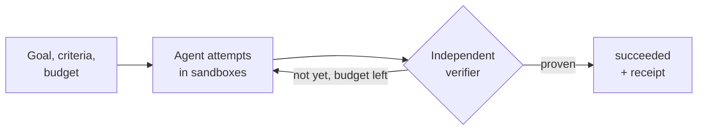

<h1 align="center">Deep Mehta</h1>

  <b>I build the machinery around AI agents that makes them safe to trust:</b> 
  sandboxes, verifiers, spend controls, and traces that explain every step.

  SDE 1 at Uniqus Consultech · Mumbai · Claude Certified Architect (Foundations)

  
  

---

## Now building: [Proofwork](https://github.com/deepmehta27/Proofwork)

Agents say "done" a lot. Proofwork only says `succeeded` when an independent verifier has proven it, and never spends past a hard dollar budget.

| Claim | How it gets proven |
|---|---|
| `succeeded` means the criteria passed on a clean workspace | Tamper tests: attempts that edit tests, configs or scripts must be caught |
| Spend never exceeds the budget, even with parallel attempts | Property tests over random interleavings of reserve, settle and crash |
| Crashes never lose or duplicate work | A chaos suite that kills workers mid-step |

Status: design stage. Measured results replace plans as each piece lands.

---

## At work

**SDE 1, Uniqus Consultech** · Mar 2026 to now
An AI app generation platform: from a prompt, to a live sandbox, to a deployed app.

- **Generation pipeline.** Contract-first parallel code generation, with the interface frozen before backend and frontend work splits. Schema healing, preflight validation and one-click failure recovery. Sandbox boot time cut 4x.
- **Prototype to production.** Hardened concurrency for fifty simultaneous users, built an observability console that traces a generation end to end, and gated releases behind deterministic end-to-end tests.
- **Identity and access.** SSO, Keycloak RBAC and multi-tenant isolation, then a redesign from role-based to grant-based authorisation.
- **Cost governance.** Per-call spend metering and budget enforcement before billable work, shipped in monitoring-only mode first.
- **Reliability.** Removed a class of bugs where the system reported success on partial or interrupted work, and added human approval gates for irreversible actions.

The code is private. Happy to talk through the design.

### Before that

| When | Role | What I did |
|---|---|---|
| 2025–26 | AI Engineer, Wager Games (New York) | Built a RAG retrieval pipeline for real-time semantic search: 50% lower query latency, 80% higher throughput. Schema-driven query routing at 95% accuracy. |
| 2025 | Data & Software Engineer Intern, Alfred_ (New York) | PDF ingestion pipelines at 98%+ reliability. Cut LLM cost 25–30% with caching, token reduction and embedding reuse. |
| 2022–23 | Data Science Intern, Mathenson Records Management (Mumbai) | Fine-tuned a BERT classifier and spaCy NER on 30k+ financial documents. Macro-F1 from 80% to 94%. |

---

## Selected projects

| Project | What it is | Highlights |
|---|---|---|
| [**Proofwork**](https://github.com/deepmehta27/Proofwork) | Outcome-driven agents with verification and hard budgets | Design stage. Every claim ships with the test that proves it. |
| [**OptiMIR**](https://github.com/deepmehta27/OptiMIR-Optimized-Multi-Modal-Intelligent-Retrieval) | Multi-modal RAG for financial documents | Hybrid BM25 + vector retrieval, grounded citations, SSE streaming. 98% answer faithfulness (RAGAS). P50 latency down 77% through multi-model routing. |
| [**MCP Navigator**](https://github.com/deepmehta27/MCP_Navigator) | Multi-agent orchestrator across MCP servers | Planner, researcher and executor agents over 30 tools on 3 MCP servers. LLM-as-judge evaluation across 60+ runs. |
| [**TrustScore**](https://github.com/deepmehta27/TrustScore---LLM-Response-Reliability-Evaluation-System) | LLM reliability scoring without ground truth | Reference-free, behavioural-consistency metrics for model outputs. |
| [**Flamingo Cares**](https://github.com/deepmehta27/Flamingo-cares) | Virtual patient simulator for medical training (team project) | Claude on AWS Bedrock, Textract for medical PDFs, knowledge-base grounding. |
| [**Memory Palace**](https://github.com/deepmehta27/Memory-Palace) | Conversational study assistant (Gemini CLI buildathon) | Flashcards with mnemonics, quizzes with semantic answer checking. |

<b>Earlier ML and research</b>

 

- **NeuralBee**: beehive health monitoring from vision and audio. 96.2% precision on parasite detection. Published at [IEEE CSCITA 2023](https://ieeexplore.ieee.org/document/10104935).
- **Railway intrusion detection**: real-time YOLOv5 detection of trespassers, vehicles and animals. 1st place, [Voxel51 Visual AI Hackathon](https://github.com/deepmehta27/Voxel_Hackathon).
- **Patient clustering for readmission risk**: HDBSCAN over 130k+ patient records with SHAP explanations. [Live app](https://patient-cluster.streamlit.app/) · [Code](https://github.com/deepmehta27/Capstone_Project).

---

## How I build

- **"Done" means verified.** If a system can't prove it finished, it didn't.
- **Spend is checked before the money moves.** A budget enforced after the fact is just a report.
- **Every failure should be explainable from the trace,** without running it again.
- **Ship in monitoring mode first.** Let real usage validate the defaults before enforcement touches anyone.

---

## Toolbox

**Languages:** Python · TypeScript · SQL
**LLM systems:** Claude, OpenAI and Gemini APIs · LangGraph · CrewAI · MCP · RAG (BM25 + vector) · RAGAS · LangSmith · OpenTelemetry
**Backend:** FastAPI · Node.js · async APIs · Server-Sent Events · PostgreSQL · Supabase · Keycloak
**Infra:** Docker · E2B sandboxes · Terraform · AWS · GCP (Cloud Run)

---

## Credentials

- **Claude Certified Architect – Foundations**, 2026 · [Credly](https://www.credly.com/badges/6cd3ec08-e826-4f33-9254-2707b4bd4ec5/linked_in?t=tjqwiw)
- **AWS Certified Cloud Practitioner** · [Credly](https://www.credly.com/badges/32016770-a0f0-49b1-9e42-1470da080a27/public_url)
- **MS Data Science**, Pace University (GPA 3.97) · **BE Information Technology**, Mumbai University

## Elsewhere

- Engineering war stories on [LinkedIn](https://linkedin.com/in/deepmehta27)
- Animated tech explainers on Instagram [@brainwyre](https://www.instagram.com/brainwyre/)
